# Simulación del estómago: química, flujo y partículas, de lo simple a lo integrado

[](https://colab.research.google.com/github/jordicusidoroura-stack/stomach-simulation/blob/main/notebooks/fase7_representacion_2D.ipynb)


Simulación de la digestión gástrica en Python, construida en **siete fases**: primero cada proceso por separado, verificado contra soluciones exactas, y al final un modelo integrado que se valida contra datos clínicos. Cubre:
- la **química ácida**: secreción, tampón de la comida y activación de la pepsina;
- el **transporte** de especies;
- el **flujo de Navier–Stokes** con paredes peristálticas (Lattice Boltzmann escrito a mano);
- las **partículas de comida**: arrastre, rotura mecánica, erosión y criba pilórica;
- el **vaciado** por el píloro.

<p align="center">
  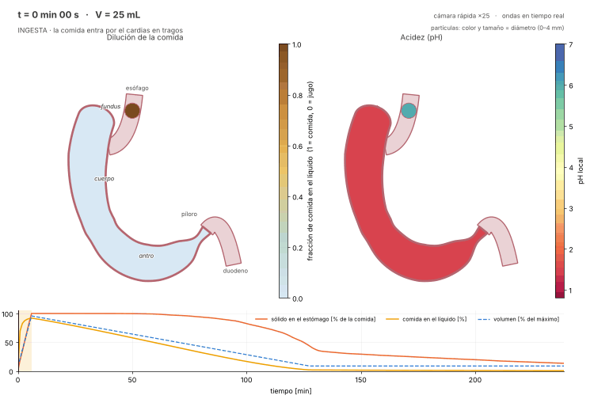
</p>
<p align="center"><em>Fase 7: cuatro horas de digestión de la comida de consenso. Izquierda: fracción de comida en el líquido (dilución). Derecha: pH local. Puntos: partículas de comida (color y tamaño = diámetro). <a href="media/fase7/03_digestion_2D.mp4">Versión MP4</a>.</em></p>

---

## Índice

1. [Motivación y pregunta de investigación](#1-motivación-y-pregunta-de-investigación)
2. [Estrategia: de lo simple a lo integrado](#2-estrategia-de-lo-simple-a-lo-integrado)
3. [Cómo se mide el error: verificación, validación y tres tipos de error](#3-cómo-se-mide-el-error)
4. [Fase 1 — Química 0D](#fase-1--química-0d-verificación-numérica)
5. [Fase 1b — Validación química con alimentos reales](#fase-1b--validación-química-con-alimentos-reales-carne-frente-a-pan)
6. [Fase 2 — Transporte 1D/2D](#fase-2--transporte-1d2d-adveccióndifusiónreacción)
7. [Fase 3 — Fluido: Lattice Boltzmann con paredes móviles](#fase-3--fluido-navierstokes-con-lattice-boltzmann-y-paredes-móviles)
8. [Fase 4 — Partículas: arrastre, rotura, erosión y criba](#fase-4--partículas-arrastre-rotura-erosión-y-criba-pilórica)
9. [Fase 5 — Visualización](#fase-5--visualización-campos-vectores-y-animaciones)
10. [Fase 6 — Modelo integrado](#fase-6--modelo-integrado-un-único-bucle-de-tiempo)
11. [Fase 7 — Representación anatómica 2D](#fase-7--representación-2d-ingesta-peristalsis-y-dilución)
12. [Resultado principal: ¿reduce el error integrar modelos?](#12-resultado-principal-reduce-el-error-integrar-modelos)
13. [Limitaciones y trabajo futuro](#13-limitaciones-y-trabajo-futuro)
14. [Cómo ejecutarlo](#14-cómo-ejecutarlo)
15. [Estructura del repositorio](#15-estructura-del-repositorio)
16. [Referencias](#16-referencias)

---

## 1. Motivación y pregunta de investigación

La digestión gástrica combina tres procesos acoplados a escalas muy distintas:

| Proceso | Escala de tiempo | Qué lo gobierna |
|---|---|---|
| Química (ácido, tampón, pepsina) | segundos a minutos | cinética de reacción y equilibrio ácido–base |
| Mecánica de fluidos (ondas antrales) | ~20 s por onda | Navier–Stokes con paredes que se deforman |
| Destrucción de la comida y vaciado | decenas de minutos a horas | rotura por contacto, erosión enzimática y criba del píloro |

Cada proceso por separado es conocido. Lo interesante es el **acoplamiento**:
- el ácido debilita la comida, y eso acelera la trituración mecánica;
- la trituración multiplica la superficie expuesta al ácido y a la pepsina;
- el flujo decide qué partículas llegan a la zona de molienda y cuándo se mezcla el jugo con la comida.

La pregunta que guía el proyecto es:

> **¿Acoplar los modelos de química, flujo y partículas reduce el error de predicción frente a datos clínicos, o solo añade parámetros e incertidumbre?**

Para contestarla con rigor hace falta que cada pieza esté **verificada**, que el error se mida **siempre con la misma vara** y que se distingan los **tipos de error** (sección 3).

---

## 2. Estrategia: de lo simple a lo integrado

```
 Fase 1    química 0D ─────────────► verificación numérica (soluciones exactas, órdenes, rigidez)
 Fase 1b   + vaciado, tampón en equilibrio ─► 1ª validación con datos clínicos (registro de errores)
 Fase 2    transporte 1D/2D ───────► ¿importa el espacio? (bolsa ácida, núcleo que se encoge)
 Fase 3    flujo LBM con paredes móviles ─► ¿cuánto mezcla el antro? ¿dónde está la cizalla?
 Fase 4    partículas + criba pilórica ─► corrige el error estructural del vaciado de sólidos
 Fase 5    visualización ──────────► campos, vectores, animaciones
 Fase 6    TODO ACOPLADO ──────────► tabla comparativa de versiones frente a los mismos datos
 Fase 7    representación anatómica ─► ingesta, peristalsis y dilución en una película
```

Cada fase:
1. **escribe sus ecuaciones gobernantes y sus hipótesis**, y dice qué hipótesis de la fase anterior relaja;
2. **verifica** el código con soluciones exactas, soluciones manufacturadas, leyes de conservación y órdenes de convergencia;
3. **termina con una batería de tests** (`assert`) que falla si algo se rompe;
4. **dice honestamente** qué parámetros son medidos, cuáles supuestos y qué queda abierto.

---

## 3. Cómo se mide el error

### Verificación frente a validación

- **Verificación**: *¿resuelvo bien mis ecuaciones?* Es un problema matemático y se comprueba con soluciones exactas, convergencia y conservación.
- **Validación**: *¿son las ecuaciones correctas?* Es un problema físico y se comprueba con datos medidos.

Un dato que se usa para **calibrar** un parámetro no se usa después para **validar**. Cada dato del proyecto lleva su etiqueta: calibración, validación o predicción.

### Tres tipos de error, contabilizados por separado

| Tipo | Pregunta | Cómo se estima | ¿Lo reduce acoplar más física? |
|---|---|---|---|
| **Numérico** | ¿Resuelvo bien las ecuaciones? | Richardson, refinamiento de malla y de paso, tolerancias | No: se controla aparte y debe ser despreciable |
| **Paramétrico** | ¿Cuánto cambia la predicción si los parámetros inciertos varían en su rango? | Monte Carlo con hipercubo latino (LHS), percentiles 5–95 | A menudo lo **aumenta**: más física implica más parámetros |
| **De modelo** (discrepancia) | ¿Cuánto se aleja la predicción de los datos? | Distancia al intervalo medido | **Es el que se espera reducir** |

El **error de modelo normalizado** de una métrica es su distancia al intervalo medido $[a, b]$, dividida por la anchura del intervalo:

$$
e_\text{mod} = \frac{\max\big(0,\; a - \hat y,\; \hat y - b\big)}{b - a}.
$$

Así, $e_\text{mod} = 0$ significa "dentro del rango normal" y $e_\text{mod} = 1$ significa "fuera por tanto como mide todo el rango". Todas las versiones del modelo escriben sus filas en un mismo **registro de validación** (`registro_validacion.csv`) y se comparan con las mismas cinco métricas clínicas.

### Las métricas clínicas de validación

| Métrica | Rango normal | Comida | Fuente |
|---|---|---|---|
| Retención gástrica a 1 h | 37–90 % | Consenso: clara de huevo, pan, mermelada y agua; 255 kcal | Consenso SNMMI/ANMS [1] |
| Retención gástrica a 2 h | 30–60 % | ídem | [1] |
| Retención gástrica a 4 h | 0–10 % | ídem | [1] |
| pH máximo tras la comida | 5,8–6,7 (rango intercuartílico) | Mixta de 1000 kcal | Russell et al. 1993 [3] |
| Tiempo hasta pH ≤ 2 | ≤ 240 min | ídem | [3] |

---

## Fase 1 — Química 0D (verificación numérica)

📓 [`notebooks/fase1_quimica_estomago.ipynb`](notebooks/fase1_quimica_estomago.ipynb)

**Por qué empezar aquí.** La química es el corazón del modelo y la única parte con soluciones exactas parciales. Antes de añadir espacio, flujo o partículas, hay que saber que se resuelve bien y conocer sus escalas de tiempo, en particular su **rigidez**.

### Hipótesis
Mezcla perfecta (0D), volumen constante, ley de acción de masas, tampón irreversible, secreción constante y actividad de la pepsina en campana gaussiana de pH.

### Ecuaciones gobernantes

Las especies son: protones $H$, tampón $B$, pepsinógeno $G$, pepsina $E$, proteína $S$ y péptidos $P$. El pH es $\mathrm{pH} = 3 - \log_{10} H$, con $H$ en mM.

**Reacciones:**

$$
\begin{aligned}
r_b &= k_b\,H\,B && \text{(R1) neutralización por el tampón}\\
r_a &= \big(k_{a1}H + k_{a2}H E\big)\,G && \text{(R2) activación ácida y autocatalítica del pepsinógeno}\\
r_e &= k_\text{cat}\,E\,\phi(\mathrm{pH})\,\frac{S}{K_M + S}, \quad \phi = \exp\!\Big[-\Big(\tfrac{\mathrm{pH}-\mathrm{pH}_\text{opt}}{\sigma}\Big)^2\Big] && \text{(R3) proteólisis (Michaelis–Menten)}\\
r_h &= k_H\,H\,S && \text{(R4) hidrólisis ácida directa}
\end{aligned}
$$

**Balances (sistema de EDOs):**

$$
\frac{dH}{dt} = r_s - r_b,\quad
\frac{dB}{dt} = -r_b,\quad
\frac{dG}{dt} = -r_a,\quad
\frac{dE}{dt} = r_a,\quad
\frac{dS}{dt} = -r_e - r_h,\quad
\frac{dP}{dt} = r_e + r_h
$$

**Invariantes exactos:**
- enzima total: $G+E = G_0 + E_0$;
- proteína total: $S + P = S_0 + P_0$;
- protones: $H + (B_0 - B) - r_s t = H_0$.

### Verificación
- Se programan a mano **Euler, Heun (RK2) y RK4**, y se comparan con cuatro **soluciones exactas** de procesos aislados:
  - T1: primer orden;
  - T2: Michaelis–Menten resuelta con la **función W de Lambert**;
  - T3: neutralización de segundo orden, que lleva a una ecuación logística;
  - T4: activación autocatalítica, de forma sigmoidea.
- **Los órdenes observados coinciden con los teóricos** (1, 2 y 4) en todos los casos: 22 de 22 tests superados.
- El modelo acoplado se compara con una referencia `Radau` (orden 5), contrastada a su vez con `DOP853`. La incertidumbre de la referencia es de $5\times10^{-12}$.
- **Autoconvergencia de Richardson**: estima el error sin conocer la solución, y es la herramienta que se usa después con Navier–Stokes.

$$
p_\text{obs} = \log_2 \frac{\lVert y_{\Delta t} - y_{\Delta t/2}\rVert}{\lVert y_{\Delta t/2} - y_{\Delta t/4}\rVert},
\qquad
e_{\Delta t/4} \approx \frac{\lVert y_{\Delta t/2} - y_{\Delta t/4}\rVert}{2^{p}-1}
$$

<p align="center">
  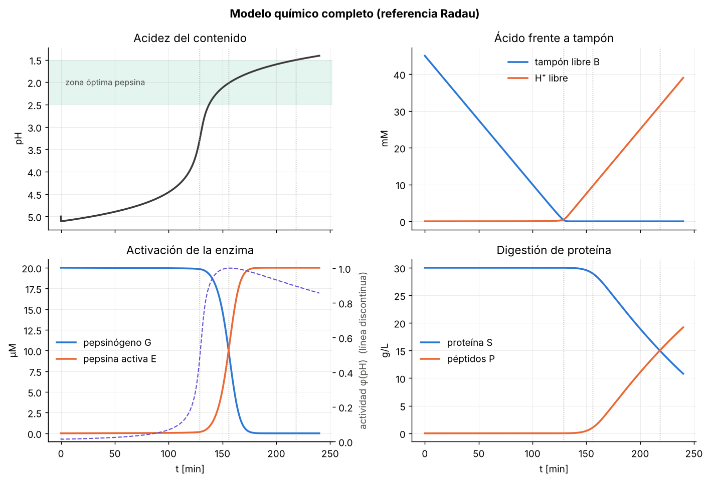
  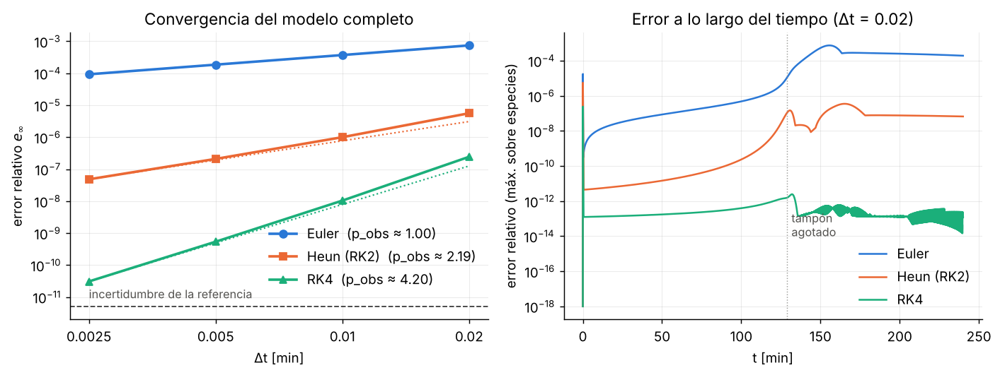
</p>

### Lo que se aprende

- **El "retardo y arranque" emerge solo, sin imponerlo.** La comida tampona el ácido y el pH se mantiene alto. Cuando el tampón se agota (≈ 129 min con estos parámetros ilustrativos), el pH cae en minutos y entonces se dispara la activación autocatalítica de la pepsina.
- **Los invariantes lineales no miden la precisión de un Runge–Kutta**, porque cualquier RK los conserva exactamente. Sí sirven para **detectar errores de programación**: el cuaderno inyecta un error a propósito (olvidar $r_h$ en $dP/dt$) y el residuo lo delata de inmediato.
- **Rigidez.** El tiempo característico de la neutralización es $\tau_b \sim 1/(k_b B_0) \approx 0{,}02$ min. Por encima de $\Delta t \approx 0{,}062$ min, RK4 se vuelve inestable. Lo más peligroso: con $\Delta t = 0{,}08$ la solución **no explota**, sino que converge a un estado *espurio* con pH ≈ 2,7. Es un resultado plausible y falso que solo el análisis de estabilidad delata.

<p align="center">
  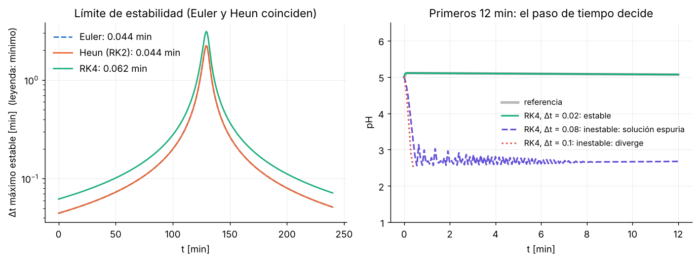
</p>

---

## Fase 1b — Validación química con alimentos reales (carne frente a pan)

📓 [`notebooks/fase1b_validacion_carne_pan.ipynb`](notebooks/fase1b_validacion_carne_pan.ipynb)

**Por qué.** La fase 1 solo comprobaba que las ecuaciones se resolvían bien. Aquí se pregunta si **son las ecuaciones correctas**, comparando con datos clínicos. Esta fase abre además el **registro de validación** que usan todas las versiones posteriores.

### Qué se añade

**Volumen variable**, con el balance escrito en cantidades $N_i$ en lugar de concentraciones:

$$
\frac{dV}{dt} = q_s(t) - Q(t),
\qquad
\frac{dN_i}{dt} = s_i(t) + V\sum_r \nu_{ir}\,r_r - Q\,\frac{N_i}{V}
$$

**Vaciado con la regla energética** del protocolo INFOGEST semidinámico [5], a 2 kcal/min:

$$
T_e = \frac{E_\text{comida}}{2\ \text{kcal/min}},\qquad Q = q_s + \frac{V_0 - V_\text{res}}{T_e}\quad (t<T_e)
$$

**Tampón en equilibrio químico**, con $n$ familias de ácido débil cuyos $pK_a$ van de 2,5 a 6,5. La variable de estado pasa a ser el **total de protones** $T$, y el pH se obtiene resolviendo:

$$
h + \sum_j B_j\,\frac{h}{h + K_{a,j}} = T
$$

Esto elimina la reacción rápida $k_b$, y con ella la rigidez de la fase 1.

**Amilasa salival**, que se inactiva al bajar el pH:

$$
r_\text{am} = k_\text{am}\,\psi(\mathrm{pH})\,c_A,
\qquad
\psi = \frac{1}{1 + 10^{\,n(\mathrm{pH}_{50}-\mathrm{pH})}}
$$

**Hidrólisis parcial de la proteína**: solo una fracción $f_\text{pep}$ es accesible a la pepsina en el estómago.

### Calibración, validación y predicción

| Uso | Datos |
|---|---|
| **Calibración** | Hidrólisis in vitro del almidón del pan (Freitas et al. 2018 [4]). Se obtiene una cota inferior: $k_\text{am} \geq 0{,}19$ min⁻¹ |
| **Validación** | Las cinco métricas clínicas de la sección 3 |
| **Predicción** | 50 g de carne frente a 50 g de pan, con banda de incertidumbre (Monte Carlo LHS) |

<p align="center">
  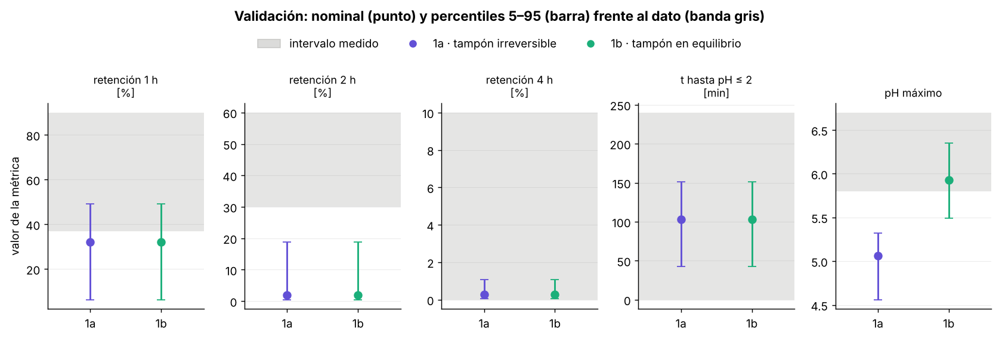
</p>
<p align="center">
  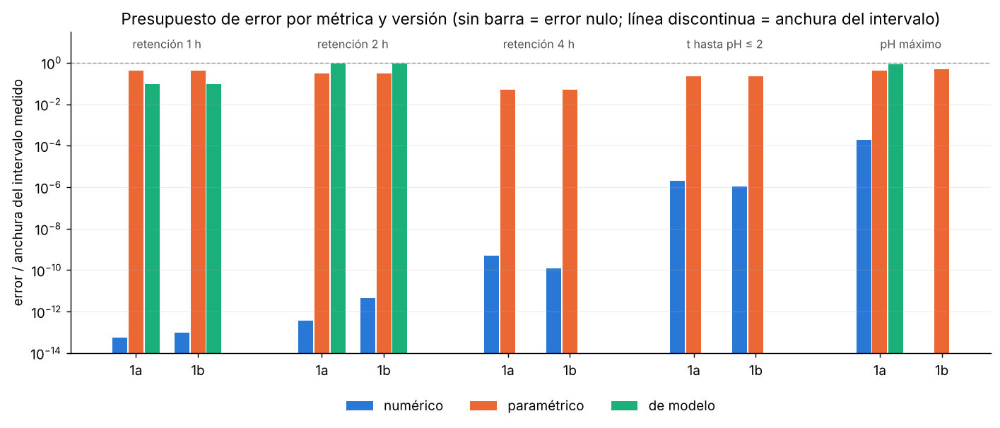
</p>

### Lo que se aprende

- **Añadir el equilibrio ácido–base reduce el error de modelo.** El pH máximo pasa de fuera a dentro del rango medido, y el error normalizado medio baja de **0,37 a 0,21**.
- **La retención a 2 h falla por mucho en las dos versiones** (≈ 2 % frente a 30–60 %), y ni siquiera la banda paramétrica llega al dato. Es un **error estructural**: el vaciado proporcional trata la comida como un líquido, pero la gammagrafía marca el **sólido**, que el píloro retiene hasta que se tritura a menos de 1–2 mm.
- Ese error no lo arregla ninguna mejora química. **Justifica cuantitativamente la fase 4.**
- El error numérico queda al menos tres órdenes de magnitud por debajo de los otros dos.

---

## Fase 2 — Transporte 1D/2D (advección–difusión–reacción)

📓 [`notebooks/fase2_transporte_1D_2D.ipynb`](notebooks/fase2_transporte_1D_2D.ipynb)

**Por qué.** El estómago no está perfectamente mezclado: el ácido entra por las **paredes** del cuerpo y la comida llega como un **bolo**. Hay que saber si el espacio importa.

### Ecuaciones

Cada especie $c_i(\mathbf x, t)$ cumple la ecuación de advección–difusión–reacción:

$$
\frac{\partial c_i}{\partial t} + \nabla\cdot(\mathbf u\,c_i) = \nabla\cdot(D_i\nabla c_i) + R_i(\mathbf c) + s_i(\mathbf x)
$$

El flujo es incompresible y se construye con una función de corriente, de modo que la divergencia discreta es exactamente cero:

$$
u = \partial_y\psi,\qquad v = -\partial_x\psi
$$

**Dos fases.**
- La **comida** es un sólido poroso inmóvil: su tampón y su proteína no se advectan.
- El **líquido** se mueve y arrastra los protones libres $h$. El flujo de protones totales es

$$
\mathbf J_T = -(D_H + D_\text{mix})\nabla h - D_\text{food}\nabla(T-h).
$$

**Cierre de mezcla $D_\text{mix}$.** La difusión molecular del H⁺ tardaría más de un día en mezclar 1 cm. La mezcla real la hacen el flujo y estructuras más pequeñas que la malla, y se representa con una difusividad efectiva. La controlan dos números adimensionales:

$$
\mathrm{Pe} = \frac{UL}{D_\text{mix}},\qquad \mathrm{Pe}_\text{celda} = \frac{U\Delta x}{D_\text{mix}}.
$$

**Discretización.**
- Volúmenes finitos conservativos.
- Advección con MUSCL y limitador de **van Leer**: TVD, de 2º orden y sin oscilaciones.
- Difusión con diferencias centradas.
- Tiempo con **SSP-RK2**, que conserva las propiedades TVD y de positividad.

### Verificación
- **Órdenes de convergencia**: upwind da 0,96, van Leer 2,00 y advección–difusión 2,09.
- **Solución manufacturada 2D** con vórtices y paredes: orden 2,11.
- Masa conservada a $10^{-15}$.
- **Positividad** de un bloque discontinuo.
- **Regresión**: con mezcla perfecta, el 2D reproduce exactamente el modelo 0D.

<p align="center">
  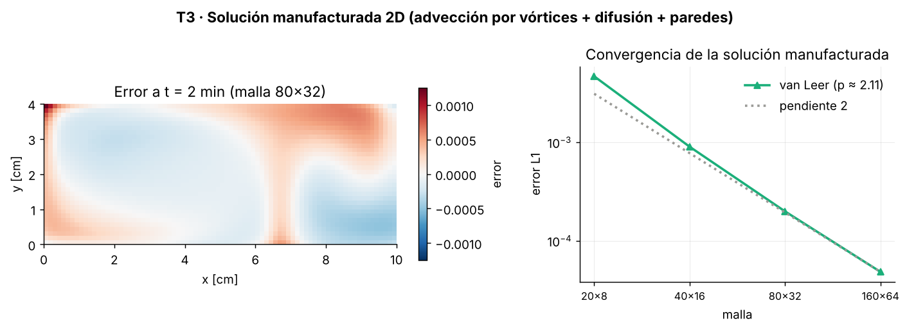
</p>

### Lo que se aprende

- **Frente ácido y bolsa ácida.** En 1D el ácido entra en la comida como un frente. Con poca dispersión, el lado secretor llega a pH < 1 mientras la comida distal sigue a pH 6. Es una versión 1D de la **bolsa ácida** (*acid pocket*) que se observa clínicamente.
- **La mezcla perfecta es optimista.** En un bolo de carne de 50 g, el 2D hidroliza **aproximadamente la mitad de proteína** que el 0D a los 60 min. El cuello de botella es la **entrada del ácido en el sólido**: el bolo se acidifica desde fuera, como un núcleo que se encoge (*shrinking core*).
- **El flujo del líquido, por sí solo, apenas acelera la química de un bolo compacto. Lo que la acelera es romperlo**, porque romper multiplica la superficie. Es la justificación física de la fase 4.
- $D_\text{mix}$ es la principal incertidumbre de esta fase. Con $D_\text{mix}$ pequeño, el Péclet de celda es alto y parte de la mezcla que se ve es **numérica**. La fase 3 sirve para acotar este parámetro.

<p align="center">
  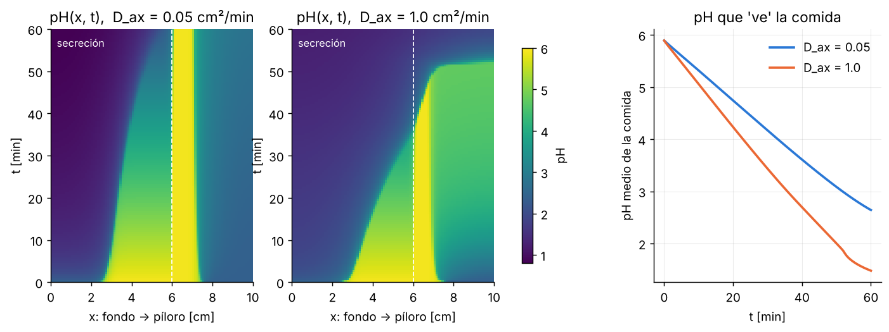
  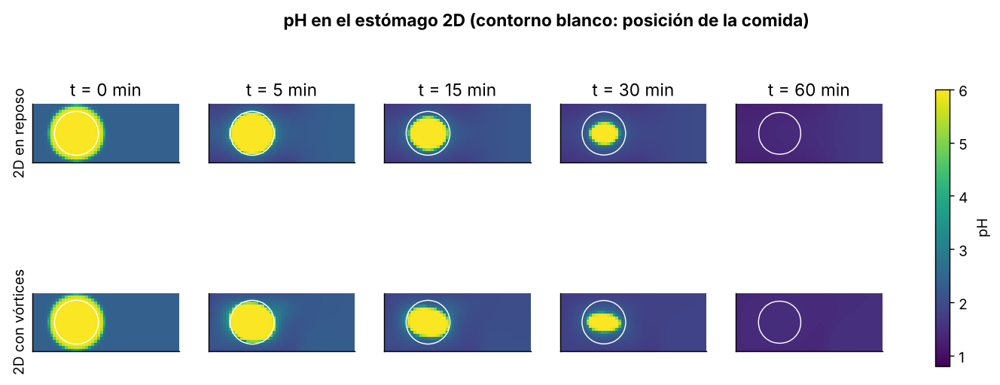
</p>
<p align="center">
  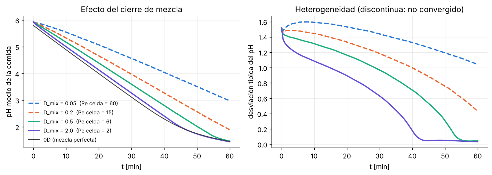
</p>

---

## Fase 3 — Fluido: Navier–Stokes con Lattice Boltzmann y paredes móviles

📓 [`notebooks/fase3_fluido_LBM.ipynb`](notebooks/fase3_fluido_LBM.ipynb)

**Por qué Lattice Boltzmann.**
- Maneja con naturalidad paredes que se mueven y cambian de forma: cada nodo es fluido o sólido.
- Es local y explícito, así que se paraleliza casi perfectamente en GPU.
- Da el **tensor de tensiones sin derivar** el campo de velocidades.

El núcleo está escrito una sola vez y funciona con **NumPy (CPU), CuPy o JAX (GPU)**.

### Ecuaciones

**Lattice Boltzmann BGK** en la red D2Q9, con el término de fuerza de Guo $S_i$. Cada paso tiene una colisión local y una propagación a los vecinos:

$$
f_i^\ast = f_i - \frac{1}{\tau}\big(f_i - f_i^\text{eq}\big) + S_i,
\qquad
f_i(\mathbf x + \mathbf c_i, t+1) = f_i^\ast(\mathbf x, t)
$$

El equilibrio es

$$
f_i^\text{eq} = w_i\,\rho\Big[1 + 3\,\mathbf c_i\cdot\mathbf u + \tfrac92(\mathbf c_i\cdot\mathbf u)^2 - \tfrac32|\mathbf u|^2\Big].
$$

**Límite macroscópico** (expansión de Chapman–Enskog, a número de Mach bajo): Navier–Stokes débilmente compresible,

$$
\partial_t\rho + \nabla\cdot(\rho\mathbf u)=0,\qquad
\partial_t(\rho\mathbf u) + \nabla\cdot(\rho\mathbf u\mathbf u) = -\nabla p + \nabla\cdot\big[\rho\nu(\nabla\mathbf u + \nabla\mathbf u^T)\big] + \mathbf F,
$$

con

$$
p = \frac{\rho}{3},\qquad \nu = \frac{\tau - 1/2}{3}\quad\text{(unidades de red)}.
$$

**Tensiones sin derivadas**, a partir de la parte de no equilibrio:

$$
\sigma_{\alpha\beta} = -\Big(1-\frac{1}{2\tau}\Big)\sum_i\big(f_i - f_i^\text{eq}\big)c_{i\alpha}c_{i\beta}
$$

**Paredes.**
- Rebote a mitad de enlace (*halfway bounce-back*): impone velocidad nula con 2º orden.
- Pared móvil de Ladd: $f_{\bar i} = f_i^\ast - 6w_i\rho\,\mathbf c_i\cdot\mathbf u_w$.
- Los nodos que pasan de sólido a fluido se rellenan con el equilibrio local.

### Verificación (9 de 9 tests)

| Test | Resultado |
|---|---|
| Poiseuille (fuerza volumétrica + paredes) | orden 2,01 |
| Couette (pared móvil) | exacto ($9\times10^{-14}$) |
| Taylor–Green (viscosidad + orden) | orden 1,99; viscosidad con error del 0,17 % |
| **Bombeo peristáltico frente a Shapiro et al. (1969)** [6] | error ≈ 1 % |
| Antro: Mach, compresibilidad y deriva de masa | Ma = 0,067; $\lvert\rho-1\rvert$ = 0,6 %; deriva de $3\times10^{-4}$ |

El test de Shapiro es el decisivo, porque usa exactamente la maquinaria de paredes que se deforman. La teoría de lubricación da el caudal medio de una onda peristáltica de amplitud relativa $\phi$:

$$
\frac{\bar Q}{c\,a} = \frac{3\phi^2}{2 + \phi^2}.
$$

<p align="center">
  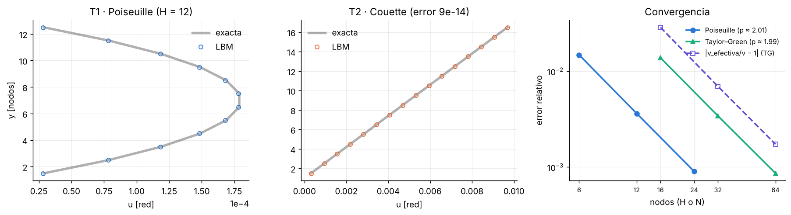
</p>
<p align="center">
  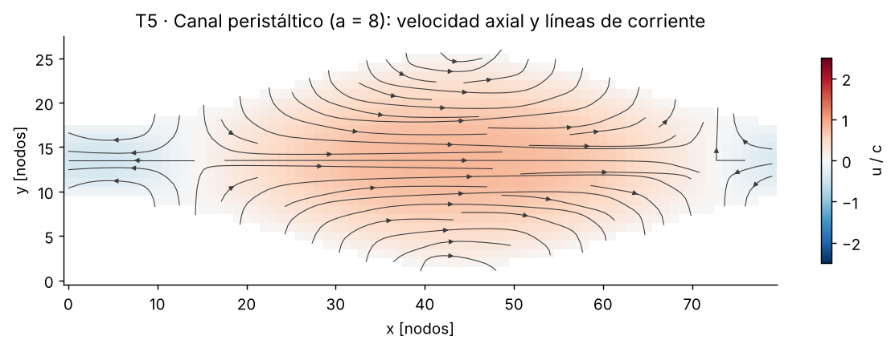
</p>

### El antro

**Montaje.**
- Dominio de 10 × 4 cm.
- Ondas que nacen en $x = 4{,}5$ cm, avanzan a 2,5 mm/s, una cada 20 s, y ocluyen hasta el 70 % de la luz.
- Píloro cerrado.
- Viscosidad de 0,1 cm²/s y Re = 5.

**Resultados.**
- **Chorro retropulsivo** de hasta 0,75 cm/s, tres veces la velocidad de la onda: el contenido atrapado contra el píloro escapa hacia atrás por el estrechamiento.
- La **cizalla máxima** es de ~0,1 Pa, y se concentra junto a la oclusión.
- **Mezcla medida con trazadores**: $D_\text{ef}$ axial de 0,2–0,36 cm²/min, del orden del $D_\text{mix}$ que la fase 2 tuvo que suponer.

<p align="center">
  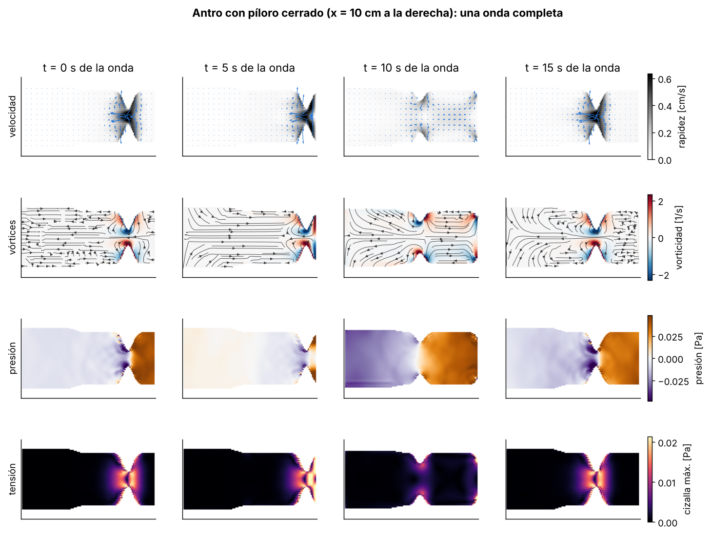
</p>
<p align="center">
  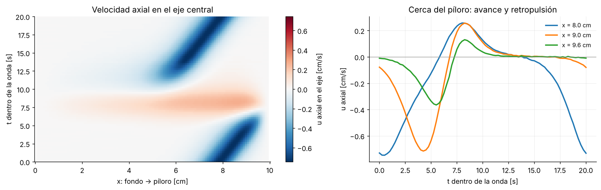
  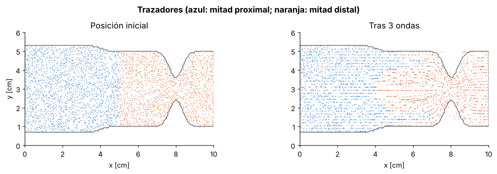
</p>

---

## Fase 4 — Partículas: arrastre, rotura, erosión y criba pilórica

📓 [`notebooks/fase4_particulas.ipynb`](notebooks/fase4_particulas.ipynb)

**Por qué.** La fase 1b identificó como error de modelo dominante el **vaciado de sólidos**, y la fase 2 mostró que **romper la comida** es lo que acelera su química. Esta fase convierte la comida en una población de partículas.

### Ecuaciones

**Arrastre y sedimentación**, con la ecuación de Maxey–Riley simplificada y la corrección de Schiller–Naumann:

$$
\frac{d\mathbf v}{dt} = \frac{\mathbf u(\mathbf x_p,t) - \mathbf v}{\tau_p} + \Big(1-\frac{\rho_f}{\rho_p}\Big)\mathbf g,
\qquad
\tau_p = \frac{\rho_p d^2}{18\mu\,(1 + 0{,}15\,\mathrm{Re}_p^{0{,}687})}
$$

Se integra con su **solución exacta para $\mathbf u$ congelada** durante el paso. Este integrador exponencial es estable aunque $\tau_p \ll \Delta t$.

**Rotura por contacto con la pared.** La frecuencia de rotura de una partícula de tamaño $d$ es el producto de cuatro factores:

$$
S(d,t) = f_{TA}(d)\cdot q\cdot H(d - g_\text{min})\cdot P_\text{rot}(d,t),
\qquad
P_\text{rot} = \mathrm{clip}\!\left(\frac{F_\text{max} - \sigma_c d^2}{F_\text{max}-F_\text{min}}, 0, 1\right)
$$

- $f_{TA}(d)$ es la frecuencia de visitas a la zona de molienda, medida en el flujo LBM.
- $q$ es la probabilidad de quedar atrapada.
- $H(d - g_\text{min})$ vale 1 si la partícula no cabe por el hueco de la oclusión.
- $P_\text{rot}$ es la probabilidad de que la fuerza de contracción, entre 0,2 y 2 N, supere la resistencia.

La rotura es binaria en mitades iguales de volumen: $d \to d/2^{1/3}$.

**Acoplamiento químico–mecánico: el ácido ablanda la comida.** La resistencia cae con la exposición acumulada al ácido:

$$
\sigma_c(t) = \sigma_{c0}\big[w_\infty + (1-w_\infty)\,e^{-X/X_w}\big],
\qquad
X(t) = \int_0^t \max(0,\ \mathrm{pH}_\text{ref}-\mathrm{pH})\,dt'
$$

**Erosión por la pepsina**: la superficie retrocede (núcleo que se encoge) a una velocidad que depende del pH:

$$
\frac{dd}{dt} = -r_{e0}\,\exp\!\Big[-\Big(\tfrac{\mathrm{pH}-\mathrm{pH}_\text{opt}}{\sigma}\Big)^2\Big]
$$

**Criba pilórica**: solo salen las partículas con $d < d_c$, con $d_c$ entre 1 y 2 mm.

**Balance de poblaciones** en una malla geométrica en volumen ($v_{i+k} = 2v_i$). Con ella, la rotura binaria lleva exactamente de la celda $i$ a la $i-k$:

$$
\frac{dN_i}{dt} = -S_iN_i + 2S_{i+k}N_{i+k} - e_iN_i + e_{i+1}N_{i+1} - k(t)\,N_i\,\mathbf 1[d_i<d_c]
$$

Dos implementaciones independientes resuelven las mismas leyes: **Monte Carlo lagrangiano** y **balance de poblaciones**. Si coinciden, las dos son correctas.

### Verificación (8 de 8 tests)

- Rotura con tasa constante frente a la solución exacta de Poisson: $5\times10^{-11}$.
- El error del Monte Carlo cae como $N^{-1/2}$.
- La erosión en el balance de poblaciones tiene orden 1 en la malla de tamaños, como corresponde a un esquema *upwind*.
- La masa se conserva a $10^{-15}$.
- Sedimentación de Stokes y velocidad terminal con Schiller–Naumann.
- El Monte Carlo y el balance de poblaciones coinciden en la retención con 1,3 puntos de diferencia.

<p align="center">
  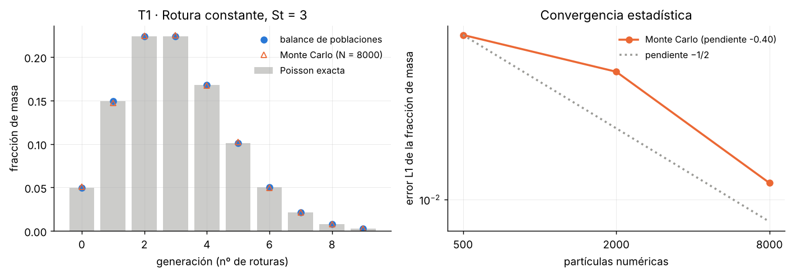
  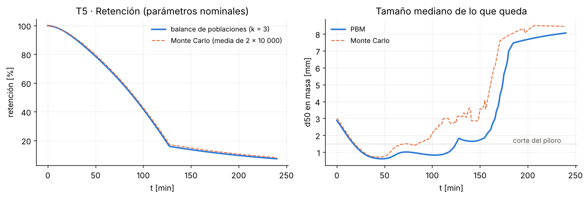
</p>

### Lo que se aprende

- Las tensiones del fluido (~0,1 Pa) son **5–6 órdenes de magnitud menores** que la resistencia de la comida. **La trituración es mecánica de pared**, no hidrodinámica.
- Con solo un 3 % más de densidad que el quimo, las partículas **sedimentan** en la pared inferior. Visitan la zona de molienda unas 0,45 veces por minuto, aproximadamente una vez cada 6 contracciones.
- **La criba pilórica corrige el error estructural.** Aparece la **fase de latencia** característica de la gammagrafía, y el error de modelo de las retenciones baja de **0,34 (fase 1b) a 0,06 (fase 4)**.
- **El ácido acelera la trituración**: a 2 h quedan retenidos 24 % con debilitamiento ácido y 32 % sin él.

<p align="center">
  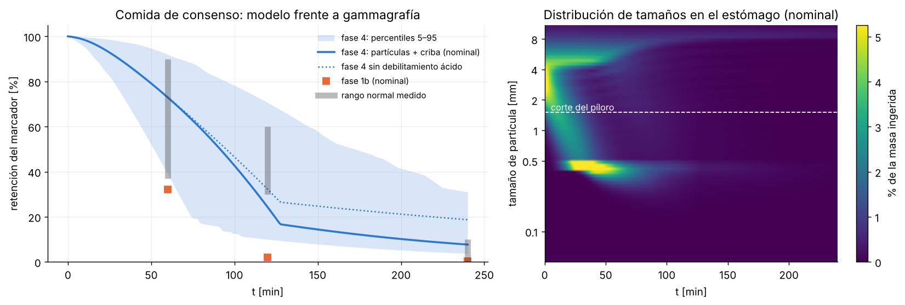
</p>
<p align="center">
  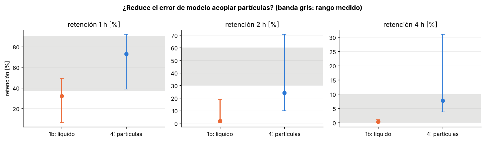
</p>

---

## Fase 5 — Visualización: campos, vectores y animaciones

📓 [`notebooks/fase5_visualizacion.ipynb`](notebooks/fase5_visualizacion.ipynb)

Esta fase reúne un módulo de funciones reutilizable:
- **mapas de color** secuenciales para magnitudes y divergentes centrados en cero para magnitudes con signo;
- `quiver` con flechas normalizadas;
- `streamplot`;
- **vorticidad** y **criterio Q** para distinguir núcleos de vórtice de capas de cizalla;
- diagramas espacio–tiempo;
- animaciones con `FuncAnimation` en MP4 y GIF;
- figuras interactivas opcionales con Plotly.

Los campos derivados se verifican antes de usarlos. En rotación sólida, $\omega = 2\Omega$ y $Q = \Omega^2 > 0$. En deformación pura, $\omega = 0$ y $Q = -\epsilon^2 < 0$.

$$
Q = \tfrac12\big(\lVert\boldsymbol\Omega\rVert^2 - \lVert\mathbf S\rVert^2\big)
\qquad (Q>0:\ \text{domina el giro})
$$

<p align="center">
  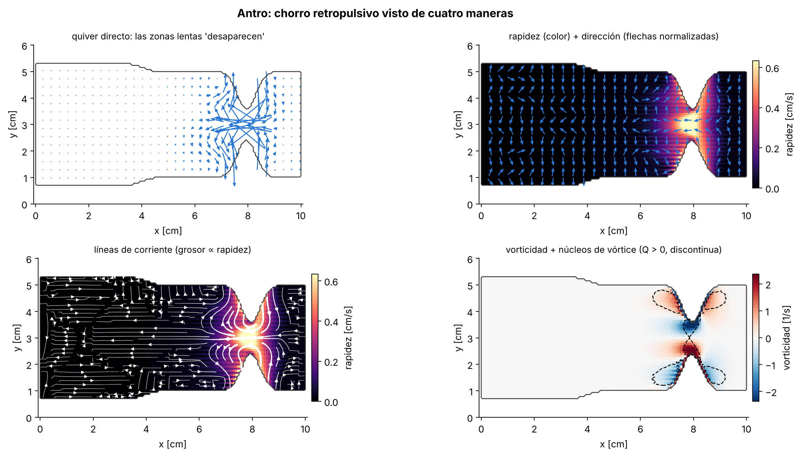
</p>
<p align="center">
  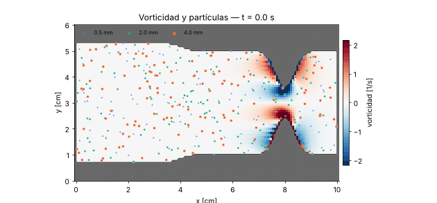
  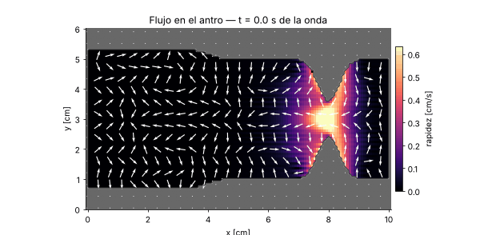
</p>
<p align="center">
  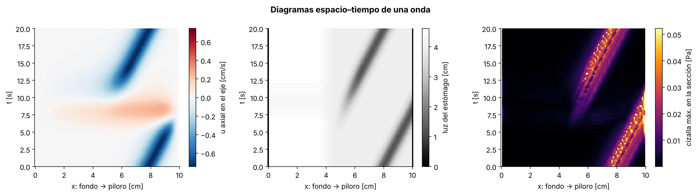
</p>

---

## Fase 6 — Modelo integrado: un único bucle de tiempo

📓 [`notebooks/fase6_modelo_integrado.ipynb`](notebooks/fase6_modelo_integrado.ipynb)

### El problema de escalas y su solución: promediado en fase

Una onda antral dura 20 s, y el LBM necesita ~7000 pasos para resolverla. Simular 4 h de digestión con LBM serían ~5 millones de pasos, unas 7 h de CPU. Se usa el método estándar para este caso, el **acoplamiento multiescala por promediado en fase**:

1. **Escala rápida.** El LBM resuelve una onda. Con trazadores se miden sus efectos promedio por onda:
   - la dispersión del líquido, $D_x(x)$ y $D_y(x)$;
   - la dispersión de las partículas que sedimentan;
   - la frecuencia de molienda $\lambda_g(x)$.
2. **Escala lenta.** El bucle integrado avanza con pasos de ~1 s usando esos **mapas**.

**Verificación del promediado (V1).** Un paseo aleatorio de Itô con $D(x)$ variable debe reproducir la dispersión del LBM directo:

$$
dx = D'(x)\,dt + \sqrt{2D(x)\,dt}\;\xi
$$

Se calibra **un solo factor**, `escala_D` ≈ 2, con la propia escala rápida y sin datos clínicos. Después se comprueba con un dato que no se usó para calibrar.

<p align="center">
  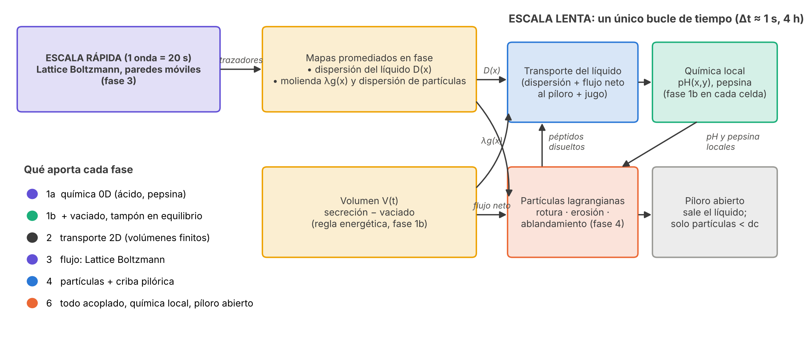
</p>

### Ecuaciones del bucle lento

**Química local** en cada celda de una losa de 25 × 10 celdas, con las especies $T$, $B$, $G$, $E$ y péptidos $P$. Se escribe en cantidades por celda, con volumen variable y espesor uniforme $h = V/(L_xL_y)$:

$$
\frac{\partial N_i}{\partial t} = \underbrace{\nabla\cdot\big(h\,\mathbf D(x)\nabla c_i\big)}_{\text{mezcla por las ondas (LBM)}}
\;-\;\underbrace{\nabla\cdot\big(\mathbf F_i\big)}_{\text{flujo neto + flujo transversal}}
\;+\;\underbrace{R_i}_{\text{química 1b}}
\;+\;\underbrace{s_i}_{\text{secreción de la pared}}
$$

**Flujo neto hacia el píloro.** Sale del balance de volumen por columnas: lo que entra por las paredes, menos lo que pierde cada columna al adelgazarse la losa, avanza hacia el píloro:

$$
\mathcal Q(x_{j+1/2}) = \sum_{k\le j}\Big[q_{\text{pared},k} - \frac{q_\text{in} - Q}{n_x}\Big],
\qquad u_b = \frac{\mathcal Q}{L_y\,h}
$$

Un **flujo transversal** $G$, que se calcula fila a fila con el mismo balance, lleva el jugo desde las paredes hacia el centro. Por construcción, **ninguna celda puede ser más ácida que el propio jugo** (test V4).

**Partículas lagrangianas** que viven en la capa del fondo. Su posición axial avanza con tres términos:

$$
dx_p = \Big[\alpha(d)\,u_b(x_p) - \gamma\,(L_x - x_p)\frac{d\ln L}{dt} + D_p'(x_p)\Big]dt + \sqrt{2D_p\,dt}\;\xi
$$

- $\alpha(d) = 6\,\tfrac{y_c}{L_y}\big(1-\tfrac{y_c}{L_y}\big)$ es la fracción del flujo neto que nota una partícula sedimentada (perfil parabólico).
- El término en $\gamma$ es el arrastre por la pared que se contrae al vaciarse el estómago ($L\propto V^{1/3}$).
- $D_p$ es la dispersión de las partículas medida con LBM.

Cada partícula se ablanda con el **pH de su celda**, se rompe a la frecuencia $\lambda_g(x)$ y se erosiona con el **pH y la pepsina locales**. Lo erosionado pasa a ser **péptidos disueltos en esa celda**.

**Píloro abierto.** El líquido sale con su composición local. Las partículas con $d < d_c = 1{,}5$ mm pasan y las grandes vuelven por retropulsión.

### Verificación del bucle integrado

| Test | Resultado |
|---|---|
| V1 el promediado reproduce la dispersión del LBM | cociente 0,67 a 6 ondas (criterio 0,5–2) |
| V2 conservación de la masa de comida | $1{,}4\times10^{-15}$ |
| V3 conservación de protones | $6{,}4\times10^{-13}$ |
| V4 el pH nunca es más ácido que el jugo | se cumple |
| V5 discretización: malla 40 × 16 y $\Delta t/2$ | ≤ 4,1 puntos de retención (criterio < 8) |

<p align="center">
  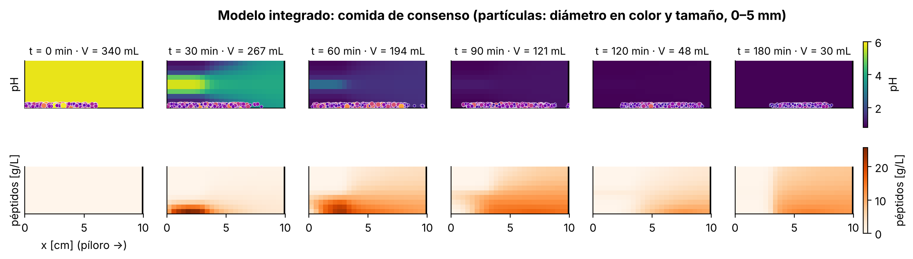
</p>
<p align="center">
  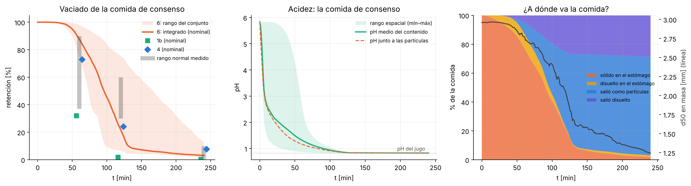
</p>
<p align="center">
  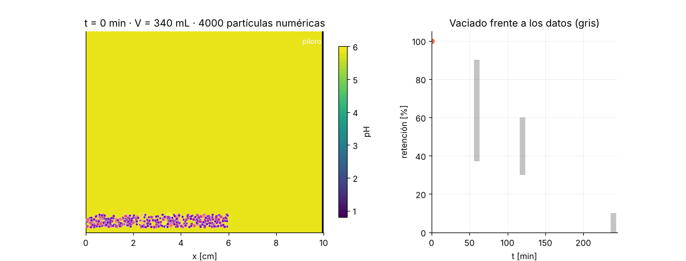
</p>

---

## Fase 7 — Representación 2D: ingesta, peristalsis y dilución

📓 [`notebooks/fase7_representacion_2D.ipynb`](notebooks/fase7_representacion_2D.ipynb)

### Qué se añade al modelo integrado

- **Estado inicial en ayunas**: 25 mL de jugo a pH 1,5.
- **Ingesta** por el cardias durante 6 min, en 18 tragos. El caudal de comida y el balance de volumen son:

$$
q_c(t) = \frac{V_\text{comida}}{t_\text{ing}}\,\mathbf 1[t < t_\text{ing}],
\qquad
\frac{dV}{dt} = q_\text{jugo} + q_c - Q_\text{píloro}
$$

- **Trazador de dilución** $M$: la fracción del líquido que procede de la comida, con $M = 1$ para comida pura y $M = 0$ para jugo. Se transporta como cualquier especie, y el jugo que entra lo diluye:

$$
\frac{\partial(Mh)}{\partial t} + \nabla\cdot(\mathbf u_b Mh) = \nabla\cdot\big(h\,\mathbf D\nabla M\big) + \frac{q_c}{A_\text{card}}\mathbf 1_\text{cardias}
$$

- **Esquema upwind según el signo del caudal en cada cara.** Durante la ingesta el estómago crece y el flujo neto puede ir hacia el fundus.

### Cómo se dibuja

La losa del modelo se proyecta sobre una "J" anatómica: un *spline* $\mathbf c(s)$ con su normal $\mathbf n$ hacia la curvatura menor. Así $y = 0$ queda en la curvatura mayor, que es donde sedimentan las partículas:

$$
\mathbf P(x,y) = \mathbf c(x) + \Big(\frac{y}{L_y}-\frac12\Big)\,w(x,t)\,\mathbf n(x),
\qquad
w = w_0(x)\,f_V\big(x, V(t)\big)\,\big(1-\phi(x,t)\big)
$$

- $f_V$ representa la **relajación receptiva**: el fundus y el cuerpo se distienden con el volumen.
- $\phi$ son las **ondas peristálticas**, con los mismos parámetros que el LBM: 0,25 cm/s, periodo de 20 s y amplitud que crece de $x = 4{,}5$ a $x = 6{,}5$ cm.

<p align="center">
  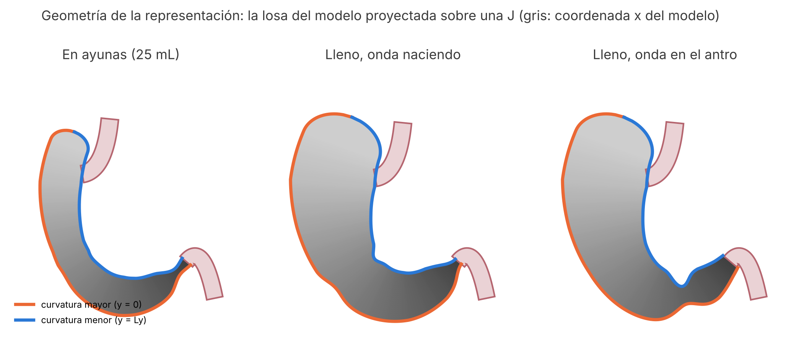
</p>
<p align="center">
  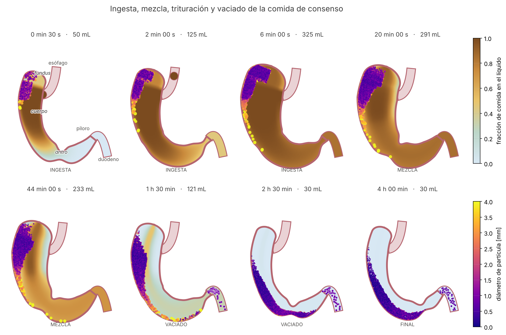
</p>

### Lo que muestra la película

1. **Ingesta (0–6 min).** El estómago pasa de 25 a ~325 mL, la comida tampona el contenido hasta pH ≈ 5,5 y las partículas se apilan en la curvatura mayor.
2. **Mezcla (6–45 min).** El jugo entra por las paredes y forma un **anillo ácido** alrededor de un núcleo de comida tamponado. Es la estratificación intragástrica que describen los estudios de resonancia.
3. **Vaciado (45–150 min).** El antro tritura las partículas y las pequeñas pasan al duodeno con el quimo diluido y ácido. El $t_{1/2}$ de vaciado de sólidos es de ≈ 125 min.
4. **Final.** Queda jugo ácido y un resto de partículas que se vacían despacio.

<p align="center">
  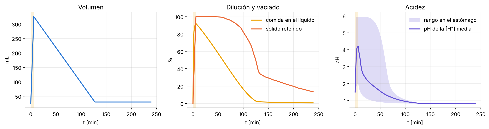
</p>

---

## 12. Resultado principal: ¿reduce el error integrar modelos?

Estas son las mismas cinco métricas clínicas para las cuatro versiones del modelo. ✅ indica que el valor cae dentro del rango normal medido.

| Métrica | Rango normal | 1a · química 0D | 1b · + tampón en equilibrio | 4 · + partículas y criba | **6 · integrado** |
|---|---|---|---|---|---|
| Retención 1 h [%] | 37–90 | 32,1 ❌ | 32,1 ❌ | 72,9 ✅ | **87,8 ✅** |
| Retención 2 h [%] | 30–60 | 1,9 ❌ | 1,9 ❌ | 24,2 ❌ | **21,8 ❌** |
| Retención 4 h [%] | 0–10 | 0,3 ✅ | 0,3 ✅ | 7,7 ✅ | **3,1 ✅** |
| pH máximo | 5,8–6,7 | 5,1 ❌ | 5,9 ✅ | — | **5,9 ✅** |
| t hasta pH ≤ 2 [min] | 0–240 | 103 ✅ | 103 ✅ | — | **75 ✅** |
| **Métricas dentro del rango** | | 2 / 5 | 3 / 5 | 2 / 3 | **4 / 5** |
| **Error de modelo normalizado (media)** | | 0,370 | 0,206 | 0,064 | **0,055** |

<p align="center">
  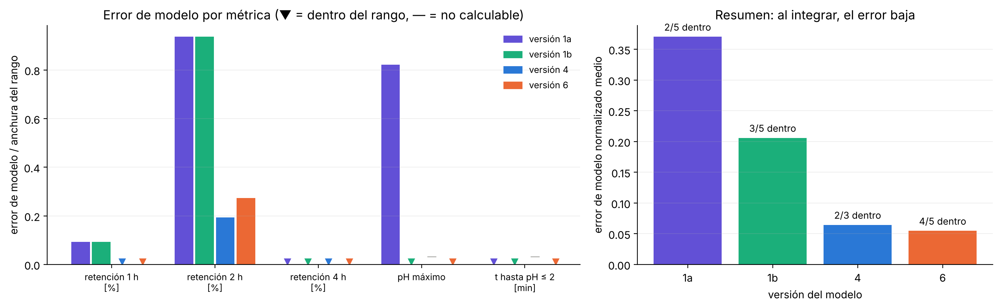
</p>

**Respuesta a la pregunta de investigación.**

- **Sí, el error de modelo baja** de forma casi monótona al integrar: 0,37 → 0,21 → 0,06 → 0,055. Cada mejora ataca el error que la validación anterior había señalado:
  - el **equilibrio ácido–base** arregla el pH;
  - las **partículas con criba** arreglan la forma del vaciado.
- **La versión integrada es la única que cumple a la vez las métricas de vaciado y las de pH.** Además, produce fenómenos que los modelos 0D no pueden tener: la capa ácida junto a las paredes, el núcleo tamponado, la trituración en el antro y los péptidos que salen con el flujo neto.
- **La mejora no es uniforme.** En la retención a 2 h, la versión 4 (24 %) se acercaba algo más al rango que la integrada (22 %). Integrar añade física, pero también **cierres nuevos con su propia incertidumbre**.
- **El error paramétrico no baja**: más física implica más parámetros sin medir. Para que el modelo integrado gane precisión neta hacen falta **datos que acoten los parámetros**, y el presupuesto de error indica cuáles.
- **El error numérico** queda siempre varios órdenes de magnitud por debajo de los otros dos. No limita ninguna conclusión.

---

## 13. Limitaciones y trabajo futuro

Es un proyecto **docente y exploratorio**, no una herramienta clínica.

- **Parámetros.** Muchos son órdenes de magnitud ilustrativos o rangos de la literatura; cada cuaderno indica su origen. Los mecánicos (resistencia de la comida, probabilidad de atrapar, ablandamiento por el ácido) **no están medidos**.
- **Geometría.** El modelo es una losa 2D de 10 × 4 cm. La forma anatómica de la fase 7 es un **dibujo** sobre el que se proyectan los resultados, no un cálculo en esa geometría.
- **Promediado en fase.** El modelo integrado no ve cada onda individual, sino sus efectos medios. Su incertidumbre (`escala_D`) se recorre en el conjunto paramétrico.
- **Parámetro más sensible.** Es $\gamma$: cuánto arrastra la pared a las partículas sedimentadas. Gobierna la retención a 2 h. Medirlo, por ejemplo con resonancia de la distribución intragástrica de sólidos, es el siguiente paso más útil.
- **Fase 7.** Con ingesta, la retención queda en ≈ 99 / 59 / 13 % a 1, 2 y 4 h: ligeramente lenta. No se ha recalibrado nada para esta fase.
- **GPU.** El código JAX/CuPy y el de Plotly están protegidos para que los cuadernos funcionen sin esas librerías, y se han probado menos que el de NumPy.

**Trabajo futuro**
1. Acoplamiento directo LBM–transporte en GPU durante la ingesta, sin promediado en fase.
2. Medidas para acotar los parámetros más influyentes: curvas de titulación de los alimentos, ensayos de compresión de la comida digerida e hidrólisis in vitro con INFOGEST.
3. Geometría 3D realista y complejo motor migratorio para vaciar los restos.

---

## 14. Cómo ejecutarlo

**En Google Colab (recomendado)**: abre cualquier fase y ejecuta *Entorno de ejecución → Ejecutar todas*. No hay que instalar nada.

| Fase | Colab | Tiempo en CPU |
|---|---|---|
| 1 · Química 0D | [abrir](https://colab.research.google.com/github/jordicusidoroura-stack/stomach-simulation/blob/main/notebooks/fase1_quimica_estomago.ipynb) | < 1 min |
| 1b · Validación carne/pan | [abrir](https://colab.research.google.com/github/jordicusidoroura-stack/stomach-simulation/blob/main/notebooks/fase1b_validacion_carne_pan.ipynb) | ~ 5 min |
| 2 · Transporte 1D/2D | [abrir](https://colab.research.google.com/github/jordicusidoroura-stack/stomach-simulation/blob/main/notebooks/fase2_transporte_1D_2D.ipynb) | ~ 7 min |
| 3 · Fluido LBM | [abrir](https://colab.research.google.com/github/jordicusidoroura-stack/stomach-simulation/blob/main/notebooks/fase3_fluido_LBM.ipynb) | ~ 5 min (GPU opcional) |
| 4 · Partículas | [abrir](https://colab.research.google.com/github/jordicusidoroura-stack/stomach-simulation/blob/main/notebooks/fase4_particulas.ipynb) | ~ 5 min |
| 5 · Visualización | [abrir](https://colab.research.google.com/github/jordicusidoroura-stack/stomach-simulation/blob/main/notebooks/fase5_visualizacion.ipynb) | ~ 4 min |
| 6 · Modelo integrado | [abrir](https://colab.research.google.com/github/jordicusidoroura-stack/stomach-simulation/blob/main/notebooks/fase6_modelo_integrado.ipynb) | ~ 8 min |
| 7 · Representación 2D | [abrir](https://colab.research.google.com/github/jordicusidoroura-stack/stomach-simulation/blob/main/notebooks/fase7_representacion_2D.ipynb) | ~ 4 min |

Cada cuaderno es **autocontenido**. Los que necesitan el flujo de la fase 3 (4, 5, 6 y 7) lo regeneran si no encuentran `campo_antro.npz`, lo que añade unos 75 s.

**En local**:
```bash
git clone https://github.com/jordicusidoroura-stack/stomach-simulation.git
cd stomach-simulation
pip install -r requirements.txt
jupyter lab notebooks/
```
Para guardar las animaciones en MP4 hace falta `ffmpeg`. Sin él, se guardan en GIF.

---

## 15. Estructura del repositorio

```
stomach-simulation/
├── README.md
├── requirements.txt
├── .gitignore
├── notebooks/            # 8 cuadernos, uno por fase (sin salidas)
│   ├── fase1_quimica_estomago.ipynb
│   ├── fase1b_validacion_carne_pan.ipynb
│   ├── fase2_transporte_1D_2D.ipynb
│   ├── fase3_fluido_LBM.ipynb
│   ├── fase4_particulas.ipynb
│   ├── fase5_visualizacion.ipynb
│   ├── fase6_modelo_integrado.ipynb
│   └── fase7_representacion_2D.ipynb
└── media/                # figuras y animaciones generadas por los cuadernos
    ├── fase1/ … fase7/
```

Los archivos que generan los cuadernos al ejecutarse (`figuras/`, `campo_antro.npz` y `registro_validacion.csv`) no se versionan: cada cuaderno los regenera.

---

## 16. Referencias

1. Abell T.L. et al. *Consensus recommendations for gastric emptying scintigraphy* (SNMMI/ANMS). Resumen en J Nucl Med Technol 36(1):44. <https://tech.snmjournals.org/content/36/1/44>
2. Malmud L.S. et al. Valores normales de vaciado gástrico de sólidos. <https://numebook.uchile.cl/artmes/NMDigitalBook/GastrointestinalExaminations_Web/SGES_NormalValues_Malmud.htm>
3. Russell T.L. et al. (1993). *Upper gastrointestinal pH in seventy-nine healthy, elderly, North American men and women*. Pharm Res. <https://link.springer.com/article/10.1023/A:1018970323716>
4. Freitas D., Le Feunteun S. et al. (2018). *The important role of salivary α-amylase in the gastric digestion of wheat bread starch*. Food & Function. <https://pubs.rsc.org/en/content/articlehtml/2018/fo/c7fo01484h>
5. Mulet-Cabero A.-I. et al. (2020). *A standardised semi-dynamic in vitro digestion method suitable for food – an international consensus*. Food & Function. <https://pubs.rsc.org/en/content/articlehtml/2020/fo/c9fo01293a>
6. Shapiro A.H., Jaffrin M.Y., Weinberg S.L. (1969). *Peristaltic pumping with long wavelengths at low Reynolds number*. J Fluid Mech 37:799–825.
7. Krüger T. et al. (2017). *The Lattice Boltzmann Method: Principles and Practice*. Springer.
8. Ladd A.J.C. (1994). *Numerical simulations of particulate suspensions via a discretized Boltzmann equation*. J Fluid Mech 271:285–309.
9. Guo Z., Zheng C., Shi B. (2002). *Discrete lattice effects on the forcing term in the lattice Boltzmann method*. Phys Rev E 65:046308.
10. Lallemand P., Luo L.-S. (2003). *Lattice Boltzmann method for moving boundaries*. J Comput Phys 184:406–421.
11. Maxey M.R., Riley J.J. (1983). *Equation of motion for a small rigid sphere in a nonuniform flow*. Phys Fluids 26:883.
12. Schiller L., Naumann A. (1933). *Über die grundlegenden Berechnungen bei der Schwerkraftaufbereitung*. Z Ver Dtsch Ing 77:318–320.
13. Van Leer B. (1979). *Towards the ultimate conservative difference scheme V*. J Comput Phys 32:101–136.
14. Gottlieb S., Shu C.-W., Tadmor E. (2001). *Strong stability-preserving high-order time discretization methods*. SIAM Rev 43:89–112.
15. Roache P.J. (1998). *Verification and Validation in Computational Science and Engineering*. Hermosa.
